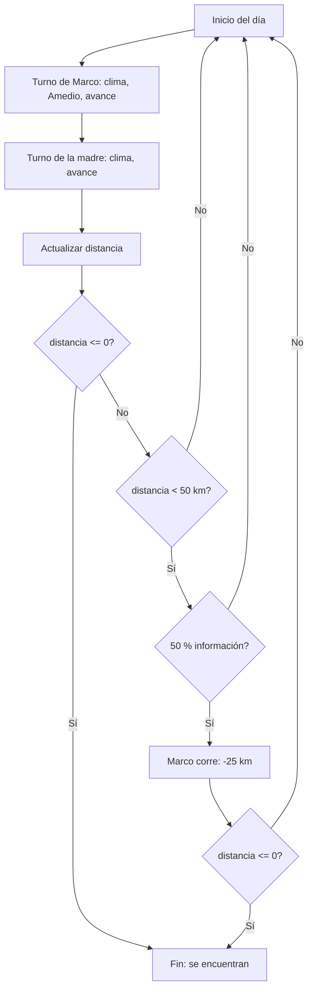

# Reglas de la simulación

## Parámetros generales

| Parámetro | Valor |
|-----------|-------|
| Distancia inicial | 350 km |
| Condición de fin | La distancia entre ambos es ≤ 0 |

## Turno de Marco

| Elemento | Regla |
|----------|-------|
| Velocidad base | Aleatoria entre 10 y 15 km/h |
| Horas de marcha | Aleatorias entre 8 y 10 h |
| Clima | Ver tabla de clima |
| Amedio se escapa (15 %) | Se pierden **2 horas** de marcha |
| Amedio se cansa (25 %) | La velocidad se multiplica por **0,90** |

**Avance de Marco** = velocidad final × horas de marcha

## Turno de la madre

| Elemento | Regla |
|----------|-------|
| Velocidad base | Aleatoria entre 6 y 9 km/h |
| Horas de marcha | Aleatorias entre 6 y 9 h |
| Clima | Ver tabla de clima |

**Avance de la madre** = velocidad final × horas de marcha

## Clima

La probabilidad es la misma para ambos, pero la penalización de velocidad es distinta:

| Clima | Probabilidad | Mensaje (Marco) | Factor Marco | Factor madre |
|-------|:------------:|-----------------|:------------:|:------------:|
| FUERTE | 10 % | ¡Ha llovido muchisimo! | × 0,25 | × 0,50 |
| NORMAL | 30 % | Ha llovido un poco | × 0,75 | × 0,75 |
| BUENO | 60 % | Ha hecho un buen dia | × 1,00 | × 1,00 |

## Actualización de la distancia

Al final de cada día:

```
distancia = distancia - (avance de Marco + avance de la madre)
```

Si `distancia ≤ 0`, Marco encuentra a su madre durante el recorrido.

## Extensión 2: información sobre mamá

Si al final del día **no se han encontrado** y la distancia es **menor de 50 km**:

- Hay un **50 %** de probabilidad de que alguien informe a Marco.
- Si ocurre, Marco corre y la distancia se reduce **25 km extra**.
- Si la distancia pasa a ser ≤ 0, se encuentran.

## Diagrama de flujo diario


